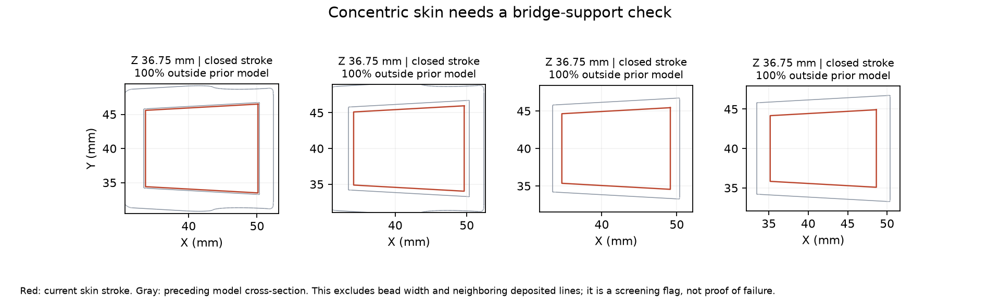

# Extrusion dynamics and revised toolpaths — checkpoint 008

**Decision: continue engineering; do not begin CAD.** A better slice reaches 52.91 seconds in the numerical planner, but its motion, extrusion response and cooling assumptions remain unsupported together. The latest user instruction explicitly keeps all CAD behind this gate. Removing the budget cap does not remove that condition.

## A missing firmware check changed the earlier result

The previous 54.2985-second calculation omitted Klipper's extruder junction constraint. This checkpoint loads the unmodified `PrinterExtruder` class from the same pinned [Klipper source](https://github.com/Klipper3d/klipper/blob/ce7002bedf37e938bb483572949f3703ac6476cb/klippy/kinematics/extruder.py), supplies its heater/configuration state without connecting to hardware, and calls its movement checks and junction calculation alongside the archived Move/LookAheadQueue classes.

For an E/XYZ movement-ratio change Δr, its junction bound is v² ≤ (E instantaneous corner velocity / |Δr|)². With E corner = 1 mm/s and a ratio change of 0.05, the permitted junction speed is 20 mm/s. This is separate from XY square-corner velocity. The extrude-only acceleration setting does not cap positive XY extrusion acceleration; a configuration that passes these checks is not proof the extruder motor can follow it.

At the earlier extreme caps (V 2400 mm/s, A2,000,000 mm/s², SCV 500, Q 300 mm³/s, first-layer speed 300), the original path changes from **54.30 to 58.66 seconds** with E corner = 1 and minimum cruise ratio0. Finite lookahead is included. MCR 0.5 gives 59.75 seconds. With E corner 10, the corresponding MCR 0 result is 56.87 seconds. Raising a software limit to obtain a smaller number does not establish a hardware capability.

## Five new slices

The original mesh/scale, 0.25 mm layers, two walls, three top and bottom layers, 10% infill, 0.5 mm line widths and nozzle remain fixed. Existing paired-layer infill remains enabled. Changes: turn combing off for direct travel, enable wall-order optimization, and vary fill direction or skin pattern. No XY contour offset, removed model feature, flow multiplier reduction or reduced solid-layer count is used.

| Trial | Deposited volume mm³ | Travel m | Time s | With 0.20 s layer floor, s |
|---|---:|---:|---:|---:|
| direct-travel | 8921.0 | 16.36 | 57.29 | 63.94 |
| lines-0 | 8927.2 | 15.13 | 55.16 | 61.97 |
| lines-90 | 8926.9 | 15.63 | 56.18 | 62.91 |
| zigzag-0 | 9619.1 | 10.81 | 53.86 | 60.98 |
| concentric-skin | 8903.1 | 13.32 | 52.91 | 60.05 |

Timing uses the same extreme caps and E corner 1/MCR 0. All five pass the existing rounding-aware width audit with zero definite width violations. This is not a full local-coverage or bridge-support certification. Concentric skins and direct travel still need preview and physical checks for center gaps, strings and nozzle contact. The zigzag variant adds material; it is not a free reduction in travel.

**Concentric skin was the initial timing candidate; the bridge check below supersedes it.** It has 8903.09 mm³ extrusion, 11.040 g at the historical assumed density 1.24 g/cm³, and 13.32m travel versus 18.38m before. Its no-floor planner result is 52.9121 seconds; layer floors 0.10/0.15/0.20/0.24 s produce54.5235/56.2798/60.0503/63.7220 seconds. These floor sums are optimistic timing allowances, not resliced cooling behavior. Q 200 instead of300 gives 63.84 seconds even without that floor. A 1,000,000 and SCV 100 at Q 300 gives 70.50 seconds. There is still little tolerance for weaker real hardware.

## Final bridge correction (supersedes the initial 52.91-second candidate)

A geometric support screen intersects the original STL at the preceding layer center and tests sampled skin centerlines against that cross-section. On the initial concentric slice it flags14 closed strokes with over half their length outside the preceding model, including13 entirely unsupported-centerline roof loops at Z36.75mm. The sequence starts with small interior loops over the cabin void. Therefore the52.91-second slice is **not the leading build candidate** despite its fast timing.

A sixth slice, `concentric-bridges`, enables Cura bridge handling while explicitly keeping wall/skin flow and all three bridge-skin densities at100%, with wall coast0. This overrides Cura bridge defaults that would otherwise reduce material. The roof becomes open crossing strokes; the closed-stroke flags fall from14 to1 across the whole model. This is an improvement in path topology, not a full bridge or coverage certification. The screen ignores bead width, same-layer neighbors and actual sparse infill; it assumes Cura slices at layer-center Z−0.125mm with the model centered on the80mm bed. It includes an analytical rectangle point-containment test. The remaining flag must be investigated.

The corrected trial has **8935.39mm³** deposited material, **53.5361s** planner time, **55.1475s** with a0.10s layer floor, and **60.3826s** with a0.20s layer floor. Q200 gives64.50s. It has zero definite rounding-aware width violations. Bridge speed remains an extreme analysis assumption; slowing real bridges has not been included. No pre-CAD gate pass is claimed.

The pressure and spatial/torque results below apply to the **uncorrected concentric-skin** slice identified by their stored hashes. They must be re-run on the corrected slice; do not relabel those numbers as its results. The explicit next operation is to investigate the remaining support flag, audit actual solid coverage/bridge anchoring, and rerun the combined dynamics on `slicing/cura-travel-study/concentric-bridges/analysis.gcode` (SHA256`1f433cc376e53d6a91ca1b6878e1910c85140c5e84e500d589a1906728327ded`).

## Pressure advance adds a second constraint

The archived [Klipper extruder C implementation](https://github.com/Klipper3d/klipper/blob/ce7002bedf37e938bb483572949f3703ac6476cb/klippy/chelper/kin_extruder.c) adds K times nominal filament velocity to filament position, then applies a triangular position filter when PA is enabled. We sample exact trapezoidal phases and integrate the filter weights per time bin. PA 0.01/0.04 s and smoothing1/4/10/40 ms are sensitivity cases, **not recommended or calibrated settings**.

For interpretation only, assume an ideal linear melt-pressure process τ·dQout/dt+Qout=Qfeed, with PA perfectly matched K=τ, constant material properties and no saturation. Under these favorable assumptions the output becomes triangular-filtered nominal flow. This analytic identity explains the smoothing tradeoff; the real hotend has not been identified as this system. Nonlinear melt pressure, filament compliance, gear backlash, dead volume, leakage and a moved/shaped XY command are not simulated.

For the revised concentric path at PA 0.04 s:

| Smoothing ms | Modeled output outside deposition intervals | Equivalent single-feed peak mm/s | Four equal feeds: peak mm/s each | Four feeds: peak accel mm/s² each |
|---|---:|---:|---:|---:|
| 40 | 10.95% | 304.9 | 76.2 | 7563 |
| 10 | 4.62% | 1030.6 | 257.7 | 104966 |
| 4 | 1.64% | 2369.7 | 592.4 | 632526 |
| 1 | 0.15% | 7042.6 | 1760.7 | 7910319 |

The single-feed equivalent divides volume among four equal inputs only for the listed four-feed kinematics; it does not divide the common melt pressure or establish an actuator design. Original deposition/travel intervals are retained. Modeled material outside them includes pre/post-print filter tails; this is not measured stringing or a finished-part defect percentage. Output mass is conserved in the calculation.

Long smoothing reduces actuator demand while spreading output through travel. Short smoothing preserves timing better while requiring rapid forward/reverse filament motion. Four stock LGX drives cannot be declared adequate from steady flow alone. For scale, the [original LGX guide](https://www.bondtech.se/downloads/QuickStartGuides/bondtech_EXT-LGX_LGX-Large-Gears-eXtruder_quick-start-guide.pdf) uses 8 mm filament travel per motor revolution: the 40 ms case corresponds to about 572 rpm per equal input, whereas the 4 ms case is about 4443 rpm. These are kinematic demands, not torque ratings. The different LGX PRO Metal has a different specified rotation distance and is not interchangeable in these numbers.

## Motion screen on the improved path

The prior sensitivity fixture is retained: independent Cartesian axes, two Nanotec SCB5618L4204-B motors per axis, assumed 60 g load per axis, 30 mm-radius7.5 g drum, rotor inertia48×10⁻⁶kg·m². It is **not** a selected cable mechanism or a complete purchased assembly. With Kalico smooth_zv and25 µs sampling:

| Smoother frequency Hz | Worst outer-wall reference-to-smoothed departure bound, mm | Peak per-motor inertial torque Nm |
|---|---:|---:|
| 200 | 1.561–1.609 | 5.15 |
| 400 | 0.516–0.566 | 5.88 |
| 800 | 0.164–0.203 | 8.05 |

The bounds compare each stroke only with its own command centerline. They are not finished-surface tolerances. The drum-load calculation excludes friction, elastic belts, electrical response and torque margin. At800 Hz the departure is smaller, but8.05 Nm peak demand is far above the approximately2.2 Nm operating-curve reference previously identified for this motor near 570 rpm at 48 V. Those maxima are not coincident torque/RPM measurements; the prior curve does not substantiate the modeled demand. The new slice alone does not rescue this fixture. High-frequency acceleration/torque remains a discretization-sensitive screening result.

## Verification and reproduction

- Pinned extruder tests check a known ratio-change junction, extrusion-only speed/acceleration limits, and rejection of excessive extrusion cross-section.
- Filter weights sum to one and preserve an interior linear ramp. Integrated material matches commanded E within sampling tolerance and is conserved through filtering, including tails.
- Repeating the original-path PA model at 25 µs and 10 µs changes peak acceleration by≤0.24% for 4–40 ms windows; the 1 ms case differs by up to 2.43%, so do not treat its peak as converged.
- An independent piecewise-polynomial Gaussian quadrature checks 58 sample times per filter width, including the peak-speed neighborhood, on the new path. Maximum position disagreement is below 0.00090 mm. This checks numerical integration, not the assumed physical pressure model.
- All five slices include settings, logs, binary/definition provenance and G-code hashes. The original model and pinned Cura 4.13.1 binary were checked before slicing. Nothing was sent to a printer.

Run `travel_optimize.py --engine <pinned CuraEngine>` into fresh trial folders; it refuses to overwrite existing slices. For existing files, `extrusion_dynamics.py --numpy-dir <dependency directory>` regenerates the baseline results. Add `--source slicing/cura-travel-study/concentric-skin/analysis.gcode --output extrusion-concentric-results.json` for the new candidate. `verify_extrusion.py <dependency directory>` runs the independent oracle. `concentric_motion.py --numpy-dir <dependency directory>` repeats the motion screen. NumPy/SciPy are required for the numerical screens; Matplotlib is only needed for `plot_progress.py`.

[Source and purchased-hardware audit](../purchasing/HIGH-FLOW-SOURCE-AUDIT.md) · [Pre-CAD gate and next evidence](../validation/PRE-CAD-GATE.md) · [Previous geometry study](GEOMETRY-AND-ALTERNATIVES.md)
