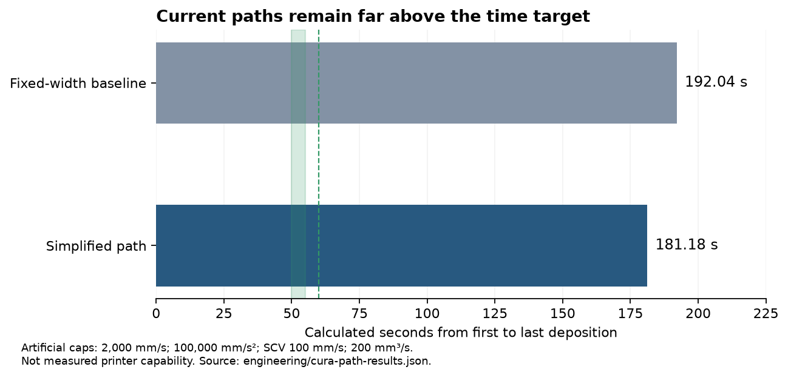

# Feasibility report — checkpoint 004

Updated 2026-09-20. **Gate NOT PASSED: stop before detailed Fusion CAD.** The tested designs and paths do not support a reliable 50–55-second full-size Benchy within **$400 of additional delivered spending**. This is a conclusion about the evidence collected, not proof that every possible printer or toolpath is incapable of the target.

Your existing Pi, CPAP fan, hose, SD card, cord, 9 mm belts/pulleys and some screws receive purchase credits. They still contribute mass and performance limits. Their exact identities and dimensions are not assumed. No questions or purchases are needed to preserve this checkpoint.

## What changed in this checkpoint

- Tested a second slicer: pinned CuraEngine 4.13.1, chosen for an independent fixed-width comparison. OrcaSlicer 2.3.2 trials remain preserved.
- Audited extrusion quantities independently and removed optional inter-wall gap filling while retaining thin-outline printing. Two Cura trials have **zero definite width violations** after accounting for G-code rounding. This is narrower than a complete competition-compliance claim.
- Simplified the path with a 0.25 mm resolution threshold and 0.05 mm maximum-deviation setting. The model remains unchanged. A repeated slice produced identical G-code bytes.
- Loaded unmodified, commit-pinned Klipper `Move` and `LookAheadQueue` classes. Four checked slices agree with the numerical timing study within one microsecond under shared caps. Finite lookahead and minimum-cruise-ratio checks are recorded separately.
- Compared four motion architectures on the same simplified Cura path using published running torque and rotor inertia, 16/20/24/32T pulley scenarios, and explicit 9 mm hardware mass allowances.

## Toolpaths and timing

The [frozen rules](../slicing/RULES.md) use the public [Annex announcement](https://www.youtube.com/watch?v=7zkKcFtLAks): original model at full size, nozzle/width no more than 0.5 mm, layers no more than 0.25 mm, two walls, three top/bottom layers, 10% infill, and permitted unfilled filament. Combining pairs of infill layers is allowed. Latest Discord-only amendments and organizer adjudication are not verified.

Project timing runs from first deposition to last, including intervening travel and Z motion; machine starts preheated and homed. Physical success remains three consecutive complete compliant prints under 60 seconds, targeting 50–55 seconds.

| Trial | Volume mm³ | Extruding / travel distance | Average flow needed for 55 s | Optimistic modeled time |
|---|---:|---:|---:|---:|
| Orca combined infill, no retraction | 8,469 | 73.41 / 13.90 m | 154.0 mm³/s | 168.52 s; width audit fails |
| Cura fixed width, no optional gap fill | 8,924 | 69.01 / 18.42 m | 162.25 mm³/s | 192.04 s |
| Cura, same settings plus simplification | 8,919 | 68.96 / 18.38 m | 162.17 mm³/s | **181.18 s** |

All times above assume **2,000 mm/s velocity, 100,000 mm/s² acceleration, 100 mm/s square-corner velocity, 200 mm³/s flow**, no minimum-cruise restriction, and no retractions. These are artificial comparison caps, not established hardware capabilities. The simplified trial takes approximately 99.29 s on walls, 31.13 s on skin, 6.02 s on infill and 44.75 s on travel. Dense corners and repeated short motions dominate; raising the advertised maximum speed alone has little effect.

The simplified path needs **118.92 s at a 75 mm³/s flow cap**, or **89.19 s at 100 mm³/s**, from deposited volume alone with zero travel and infinite acceleration. These are bounds for this slice, not universal bounds for every legal slice. At 150 mm³/s, extrusion alone consumes 59.46 s, leaving essentially no margin for travel.

A deliberately extreme sensitivity case with 3,000 mm/s, 1,000,000 mm/s² and a 400 mm³/s requested cap still gives 71.74 s. The model's separate 150 mm/s filament-feed cap limits actual peak flow to 360.79 mm³/s. This case is not a viable recommendation; it illustrates how far the current path remains from the target. [Full timing results](cura-path-results.json).

The planner cross-check validates arithmetic, not mechanics or the complete firmware. Extrusion-ratio junction limits, input-shaper delay, pressure advance, thermal behavior and actual hardware are outside that comparison. The parsers agree on Cura deposited volume; independent re-slicing agrees byte for byte. CLI header time/volume/bounds are placeholders and were not used. [Validation details](../validation/NUMERICAL-VERIFICATION.md).

Green band: 50–55-second target. Dashed line: 60 seconds.

## Motion architecture and toolhead

| Architecture | Best tested pulley at 200 mm³/s | Transmission-screen time | Main qualification |
|---|---:|---:|---|
| Independent Cartesian, lightweight moving bed | 32T | 228.52 s | Short belts and light bed; adhesion and hot-boat inertia remain concerns |
| Miniature CoreXY | 24T | 280.83 s | Includes both motors' force and inertia; diagonal motor speed matters |
| Crossed gantry Cartesian | 16T | 290.35 s | Additional synchronized moving hardware and guide alignment |
| Delta, center linearization | 32T | 199.38 s | Omits changing Jacobian and velocity-squared forces; not a full-path prediction |

These are screening scenarios, not calibrated machine times or a definitive ranking. Torque minima across each permitted motor-speed range make the acceleration caps conservative, while omitted flex and dynamics make other aspects optimistic. All use the same path and hypothetical flow cap; controller equivalence to the published motor test remains unverified. [Comparison and equations](TRANSMISSION-SCREEN.md).

No architecture is selected for manufacture. The independent Cartesian remains the simplest budget investigation; CoreXY may protect the growing print better. Delta cannot be selected from a favorable center-only model. None currently supports the gate.

The preferred 9 mm belt case budgets **140 g** for the short-Bowden head, including a provisional 4 g wider-clamp/saddle allowance. Analytical center of mass is **(0, +4.77, −2.71) mm** relative to the carriage/belt origin: X travel, Y forward, Z up. Direct drive adds 118 g, reaching 258 g. Every component mass and position is listed in [mass calculations](mechanics_results.json); these are not CAD or measured masses. Bed estimate is 89.7 g including an 11 g finished boat. Installed machine mass cannot be finalized while owned-part identities remain unknown.

For the same belt material and span, increasing width from 6 to 9 mm ideally increases axial stiffness by 50%; it also increases belt mass. It does not change RPM or rotor inertia at the same tooth count. Actual belt stiffness, tension, rail preload, hose drag, frame deflection and resonances remain unmeasured. No input-shaper frequency is presented as validated.

## Extrusion, heat and cooling

At 160 mm³/s, 1.75 mm filament feeds at 66.5 mm/s. With assumed PLA density 1.24 g/cm³ and specific heat 1.5–2.0 J/g/K, heating from 25 to 240°C requires **64–85 W of sensible heat alone**. At 200 mm³/s it requires 80–107 W. Heat loss and phase-transition enthalpy add demand. Heater watts cannot establish melt quality, nozzle pressure or extrusion-force bandwidth.

No retrieved test demonstrates the required flow through a compliant small nozzle for the costed hotend. The [original Rapido test](https://trianglelab.net/u_file/2111/01/file/Rapidohot-endMaximumPracticalFlowRateTest-5d73.pdf) uses different hardware and 0.8/1.2 mm nozzles. It does not establish the capability of Rapido 2 UHF at 0.5 mm.

The cheaper [Trianglelab CHCB-OT](https://trianglelab.net/products/trianglelab-chcb-ot-hotend-updated-kit-k1-hotend-for-sprite-extruder-creality-k1-3d-printer-creality-k1-max-cr-m4-printer) shows a $25.18 option and nominal 67 W heater. That listing neither establishes a complete standalone toolhead nor the required small-nozzle flow. It is not substituted into a claimed working $400 design.

For the assumed 0.6 m, 15 mm-ID CPAP hose and four 10×2 mm outlets, estimated losses are **2.5–2.8 kPa at 3 L/s**, or **4.4–5.0 kPa at 4 L/s**. A manufacturer's free-air maximum is not the installed operating flow. Your blower's curve and hose dimensions are unknown; the BIQU reference must not be treated as your blower. Hose support and symmetric ducts remain analytical concepts, with no manufactured duct or validated cooling performance. [Thermal and duct model](thermal_cooling_results.json).

## Budget and decision

The [reference BOM](../purchasing/CANDIDATE-BOM.md) is **$505.40 estimated delivered**: $440.81 new parts/materials, $25 shipping allowance and $39.59 estimated tax. This already credits your owned parts. The separate **$391.64 allocation is a sourcing target**, with only $8.36 margin; it is not a quoted, compatible, performance-qualified bill of materials.

A $25.18 hotend substitution alone would reduce the arithmetic estimate to about $425.30 before accounting for compatibility changes. It does not solve either gate. Shipping, tax and several commodity rows remain allowances. No checkout is represented as verified.

The accepted stop condition applies. Detailed CAD, exact manufacturing drawings, final pin assignments and build firmware are withheld because an unsupported design would falsely imply a buildable record machine. No slower or more expensive substitute is being committed.

Concrete routes forward are: (1) retain the target and obtain a substantially faster compliant path plus exact small-nozzle flow/force evidence before CAD; (2) retain the $400 budget and explicitly change the project to a test printer whose speed is measured; or (3) validate the hotend/extruder and motor/driver subsystems first, then price the proven combination. Increasing the budget alone does not establish success. No physical results have been measured.
