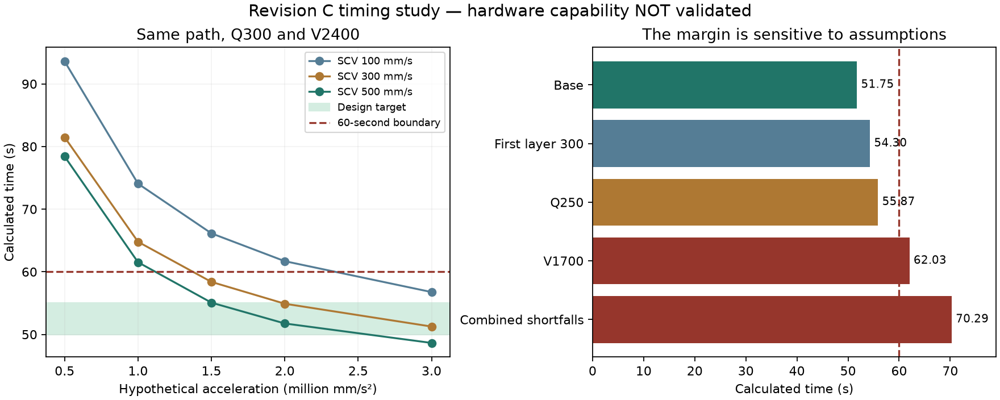

# Feasibility report — revision C, checkpoint 006

**The $400/$500 spending caps are removed. The objective is now the cheapest credible printer for a full-size, compliant 50–55-second Benchy.** Existing Pi, CPAP blower/hose, SD/cord, 9 mm belts/pulleys and some screws remain credited. Their exact specifications are not known.

The new direction is a hotend that stays stationary in XY, with a very light XY moving bed and a slow Z lift for the hotend/cooling assembly. This removes the high-flow hotend, extruders and supported cooling hose from XY acceleration. The detailed mechanism and purchased parts are not yet selected. The earlier conventional 24 V printer is not the current design.

## Checkpoint 006 update

The [new motion-smoothing study](SMOOTHING-STUDY.md) adds recovered primary evidence, actual Kalico polynomial kernels and sampling checks. The first-layer-limited case calculates 54.30 s, but a 0.20 s layer-time floor raises it to **61.29 s** (0.24 s gives 64.84 s). Smoothing reduces inertia demand while changing the commanded path. The current hardware/performance gate remains unpassed.

The creator's source is now accessible: its material-reducing slice modifications and special winch firmware are not validation of this project's stricter slice. Historical statements below about failed access describe the earlier attempt and are superseded by the new study.

## What changed

The same preserved Cura toolpath can calculate **51.75 seconds**, but only at hypothetical limits of **2,400 mm/s, 2,000,000 mm/s² (about 204 g), 500 mm/s square-corner velocity and 300 mm³/s flow**. This establishes a requirements scenario, not a validated machine or expected print time. The old 181.18-second result used much lower acceleration and remains reproducible.

A pinned, unmodified Klipper motion-planner calculation reproduces 51.75 s; a finite queue with minimum cruise ratio 0.5 gives 52.60 s. These checks omit the actual extruder junction behavior, shaping, motor tracking, structural vibration, heat transfer and physical print quality. Numerical agreement does not close the engineering gate.

The [original public rules checklist](../slicing/RULES.md), original model and its checksum remain unchanged. The current slice has no definite numerical width violations under its rounding-aware audit. Full local shell/infill coverage and physical rule compliance remain unverified.

## Timing sensitivity

Each row changes only the stated assumption from the hypothetical 51.75-second case, except the final combined case.

| Change | Calculated seconds |
|---|---:|
| Base hypothetical limits | 51.75 |
| Flow limited to 250 mm³/s | 55.87 |
| Flow limited to 200 mm³/s | 62.93 |
| Maximum speed 1,700 mm/s | 62.03 |
| Acceleration 1,500,000 mm/s² | 55.08 |
| Square-corner velocity 300 mm/s | 54.90 |
| First-layer deposition limited to 100 mm/s | 60.50 |
| First-layer deposition limited to 300 mm/s | 54.30 |
| First-layer deposition limited to 500 mm/s | 53.06 |
| Q250, V1700, A1.5 million, SCV300, first layer 300 | 70.29 |

The target is sensitive to simultaneous shortfalls. A nominal 52-second calculation is insufficient evidence of reliable sub-minute margin. The original speed limits embedded in the analysis G-code are replaced by these artificial caps; the file is not a record-attempt profile.

## What the hardware must do

The slice deposits **8,919.34 mm³**, about **11.06 g** of PLA at the assumed 1.24 g/cm³ density. Average throughput must exceed 162.17 mm³/s over 55 seconds; the scenario peaks at 300 mm³/s. A 1.75 mm feed must reach 124.73 mm/s at that peak. Sensible heating alone requires approximately 120–160 W for 25→240°C using the stated heat-capacity range; losses and phase-change enthalpy are additional. Four equal feeds would each run at 31.18 mm/s, but this is a possible thermal architecture, not a proven hotend.

The shortest modeled layer is about **0.033 s**. Cooling cannot be validated from free-air blower flow. The owned CPAP must be checked against the actual hose/duct pressure loss and cooling at the nozzle; the existing 15 mm hose example is restrictive at high flow. Keeping the hose stationary in XY removes its drag from that motion system, but does not establish adequate cooling.

At 204 g, a 60 g bed assembly experiences **120 N** of inertia force. At 90 g it is **180 N**; at 140 g, **280 N**. Holding elastic displacement to an illustrative 0.05 mm requires respectively **2,400 / 3,600 / 5,600 N/mm** effective stiffness. These figures exclude rotating inertia and are engineering targets, not measured frame properties. The growing boat alone reaches approximately 22 N of lateral inertia at full mass, making adhesion and hot-wall deformation material design issues.

## Why a bigger motor is not automatically the cheapest solution

For n identical motors sharing one independent axis, rotor inertia J, mass M, torque T and ideal pulley radius r:

`a = n T r / (M r² + n J)`

The ideal radius is `sqrt(n J / M)`. Added pulleys, belts, idlers, synchronization shafts and structural mass worsen this ideal result. CoreXY and delta need their own kinematic transformations; this formula must not be applied to them unchanged.

The [Leadshine catalog excerpt](../validation/sources/leadshine/motor-catalog-excerpt.pdf) supplies actual rotor inertias and operating curves. An illustrative four-motor independent axis using 86CM120 motors, a 60 g load, approximately 9 Nm per motor and 30% torque reserve reaches only **1.5 million mm/s²** even with ideal massless 140 mm-radius wheels. At 2,400 mm/s the motors turn about 164 rpm. This is four motors for one axis, not four motors for the whole printer. It is a screening case, not a selected BOM or certified torque margin.

Large radius also magnifies motor tracking error. A simplified 50-pole-pair sinusoidal torque model at 70% torque gives roughly **2.17 mm** rim lag at that radius. That is a quasistatic warning, not a predicted printed error; rotor acceleration, driver dynamics and compensation require a dynamic model. More microsteps do not by themselves remove load-dependent displacement. [Oriental Motor describes load-dependent angular displacement](https://www.orientalmotor.com/stepper-motors/technology/stepper-motor-overview.html).

Therefore a bank of large open-loop motors and oversized pulleys is not selected. A viable design needs lower moving mass, a better torque/inertia transmission, demonstrated tracking compensation or feedback compatible with the rules, or a substantially more efficient compliant toolpath. Buying expensive parts first would not resolve those requirements.

## Architecture decision and next work

**Preferred direction for further engineering:** stationary-XY hotend, lightweight XY bed, motors fixed to the frame, and stationary-XY CPAP duct. Compare a lightweight crossed-rod bed against a planar parallel-link bed using full path-dependent inertia and stiffness. A stacked pair of conventional rails is penalized by its carriage/rail mass; a parallel linkage adds nonlinear kinematics and firmware work. Neither mechanism is frozen yet.

The [creator's Minuteman final episode](https://www.youtube.com/watch?v=iMAWa9vfxcE) is a primary reference to investigate. Detailed settings and construction were not recovered from its transcript or video playback in this session. Do not attribute a parts list or a proven cheap derivative to that source. The public Roetz-End repository describes a separate DMD hotend and is not verified as the record hotend.

Next: obtain primary performance/settings evidence, model the two lightweight bed mechanisms, and reconcile actual motor tracking plus exact 0.5 mm-nozzle flow. Then compare complete delivered quotes. No credible minimum total price has yet been established; the historical $505.40 conventional-printer estimate does not price this new machine.

**Detailed CAD remains pending under the accepted performance gate.** No Fusion assembly, manufacturing release, usable printer.cfg or physical result is being claimed. The budget stop condition is superseded; the requirement for supported performance remains. The prior [checkpoint-004 report](FEASIBILITY-CHECKPOINT-004.md) is preserved separately.

## Reproducibility and saved state

[Complete numerical results](expanded-path-results.json), [calculation source](expanded_study.py), [design basis](DESIGN-BASIS-C.md), [resume instructions](../RESUME.md), and [backup verification](../validation/CHECKPOINT.md) are versioned in the private repository. Run the expanded study with the documented bundled Python runtime. It checks ideal-drive scaling and independently compares the target time against pinned Klipper planner classes. Results remain calculated; physical acceptance requires three consecutive compliant Benchys under 60 seconds.
