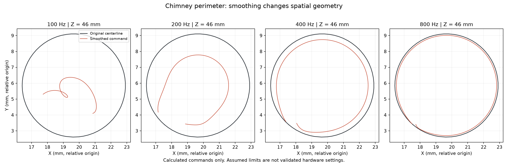

# Feasibility report — revision C, checkpoint 007

**There is no hard budget cap. The objective remains the cheapest credible printer for a full-size, compliant 50–55-second Benchy.** Existing Pi, CPAP blower/hose, SD/cord, 9 mm belts/pulleys and some screws remain credited.

The latest calculations rule out several shortcuts, but **a supported sub-minute design has not yet been established**. Detailed manufacturing CAD and final parts selection remain pending under the accepted performance gate.

- Strong motion smoothing removes millimeters of commanded outer-wall geometry. The 800 Hz sensitivity preserves it better, but its drive demand is still high.
- A four-cable bed model now includes yaw, varying cable geometry, tension allocation and rotor inertia. The tested geometry needs approximately 9.1–14.0 Nm per motor at 25 mm drum radius; it is not selected.
- Three thinner-wall slices reduce material but take 56.34–57.60 seconds at the same extreme assumed limits, versus 54.30 seconds for the baseline.
- Two independent heads reach a hypothetical 58.24 seconds only at extreme caps, before collision delays and seam validation. This lacks the target margin.

[Read the full new geometry and alternatives report](GEOMETRY-AND-ALTERNATIVES.md).

The earlier single-head calculation of **54.30 seconds** assumes V2400 mm/s, A2,000,000 mm/s², SCV500, Q300 mm³/s and a 300 mm/s first-layer cap. Adding a 0.20-second minimum-layer floor raises it to **61.29 seconds**. This is not a predicted physical printer time. The [smoothing/cooling study](SMOOTHING-STUDY.md) explains the limits; [checkpoint 006](FEASIBILITY-CHECKPOINT-006.md) preserves the detailed prior requirements report.

The preferred research direction remains a hotend stationary in XY and a lightweight XY bed, with the hotend/cooling assembly lifted slowly in Z. The moving boat needs at least 124.001 × 65.004 mm swept clearance for the currently studied ±32 × ±17 mm travel. Actual bed supports, yaw restraint and stiffness are unresolved.

**CAD status:** Fusion's blank document was converted to Hybrid Design for eventual component organization. Repeated input/focus changes prevented reliable reference-layout creation. No component, sketch, geometry, cloud save, native archive or STEP export exists. The verified destination remains Default Project / Codex Benchy Printer. This blank document is not a printer assembly or a CAD backup.

No parts have been purchased. No final delivered price, hardware pinout, usable printer.cfg or physically validated settings are claimed. The former $400/$500 prices are historical. Physical acceptance still requires three consecutive compliant Benchys under 60 seconds.

[Rules and original-model provenance](../slicing/RULES.md) · [Design basis](DESIGN-BASIS-C.md) · [Resume instructions](../RESUME.md) · [Backup verification](../validation/CHECKPOINT.md)
