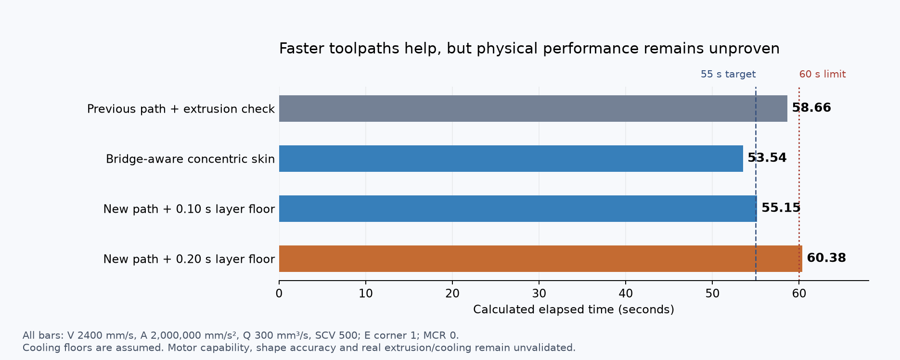

# Feasibility report — checkpoint 008

**The latest bridge-aware slice calculates 53.54 seconds. CAD readiness is still not supported.** The objective remains the cheapest credible full-size, compliant 50–55-second Benchy printer, with no hard budget cap. Your instruction keeps all CAD behind the performance gate.

This checkpoint makes three concrete improvements:

- Adding Klipper's previously omitted extrusion-junction check raises the old54.30-second estimate to58.66 seconds.
- Five optimized slices reduce travel and find an initially promising52.91-second concentric-skin path.
- A geometry check catches closed roof loops over the empty cabin. A sixth, bridge-aware slice corrects the roof path while preserving full bridge density and flow, and calculates **53.54 seconds**. The52.91-second slice is retained as a rejected candidate.

**This is a simulation at unproven hardware limits, not an expected physical print time.** It assumes2400mm/s,2,000,000mm/s² and300mm³/s. A0.10-second layer floor gives55.15 seconds; a0.20-second floor gives60.38 seconds. Q200 instead of300 gives64.50 seconds before cooling delays.

The related uncorrected slice already exceeded the tested drive arrangement's supported motor torque, and pressure-advance calculations expose large transient filament-feed demands. The corrected slice needs those checks repeated. Purchased hotend evidence does not substantiate300mm³/s through the permitted nozzle, and the owned CPAP's installed cooling performance remains unknown. One geometric support flag and full shell/bridge coverage also remain to inspect.

**Decision: no CAD yet.** There is useful toolpath progress, but the combined motion, extrusion, cooling and geometry evidence does not yet justify confidence in sub-minute performance. The preferred research direction remains a stationary-XY hotend and a very light guided XY bed.

[Complete calculations and bridge correction](EXTRUSION-AND-TOOLPATH.md) · [Remaining gate](../validation/PRE-CAD-GATE.md) · [Purchased-hardware evidence](../purchasing/HIGH-FLOW-SOURCE-AUDIT.md)

No parts purchased; no complete printer price, CAD assembly, manufacturing release, wiring or runnable printer.cfg exists yet. Fusion's last observed state remains a blank unsaved Hybrid Design; no geometry or CAD backup is claimed. The verified destination is Default Project / Codex Benchy Printer. Physical success requires three consecutive compliant Benchys under60 seconds.

[Previous report](FEASIBILITY-CHECKPOINT-007.md) · [Rules/model](../slicing/RULES.md) · [Resume state](../RESUME.md) · [Backup verification](../validation/CHECKPOINT.md)
